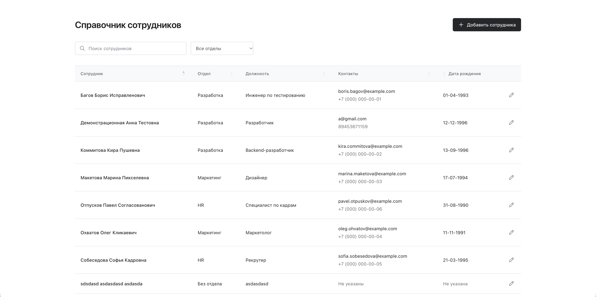
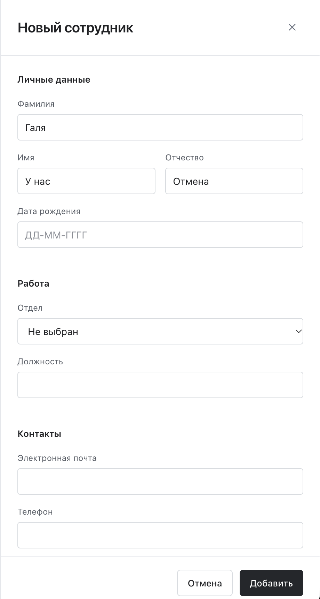

# Справочник сотрудников

Локальное приложение для хранения контактов сотрудников. Можно добавлять, редактировать и удалять записи, искать сотрудников и фильтровать их по отделам. Изменения отображаются во всех открытых вкладках.

*Проект основан на моём тестовом задании 2021 года. Позднее восстановлен локальный запуск и обновлён интерфейс. Основной функционал исходного задания сохранён.*

<details>
<summary>Интерфейс 2021 года</summary>


</details>

## Текущий интерфейс

Список сотрудников с поиском и фильтром по отделам:



Форма добавления сотрудника:



## Запуск

Понадобятся Git и запущенный Docker Desktop с Docker Compose.

```bash
git clone https://github.com/rs-an/employees_table_web_app.git
cd employees_table_web_app
docker compose up -d --build --wait
```

Откройте [http://localhost:3000](http://localhost:3000).

Первый запуск требует подключения к интернету и может занять несколько минут. Справочник будет пустым: сотрудники на скриншотах добавлены для демонстрации. Приложение работает локально, регистрация не нужна.

## Использование

- **Добавление.** Нажмите «Добавить сотрудника», заполните форму и нажмите «Добавить». Укажите хотя бы имя или фамилию; остальные поля необязательны.
- **Редактирование.** Нажмите на строку сотрудника или значок карандаша. После правок нажмите «Сохранить изменения». Кнопка «Отмена» закрывает форму без сохранения.
- **Удаление.** Откройте карточку сотрудника, нажмите на корзину и подтвердите удаление.
- **Поиск.** Введите имя, должность или контактные данные в поле поиска. Клавиша `/` переводит фокус в это поле.
- **Фильтрация и сортировка.** Выберите отдел в списке над таблицей. Для сортировки нажмите на заголовок нужного столбца.

Дата рождения вводится в формате `ДД-ММ-ГГГГ`, например `25-12-1995`. Текстовые поля вмещают до 32 символов.

Если приложение открыто в нескольких вкладках, сохранённые изменения появляются в каждой из них автоматически. При потере соединения сохранение временно недоступно: дождитесь восстановления связи и проверьте, сохранились ли последние правки.

## Остановка и повторный запуск

Чтобы остановить приложение, выполните в папке проекта:

```bash
docker compose down
```

Сохранённые сотрудники останутся доступны при следующем запуске:

```bash
docker compose up -d --wait
```
